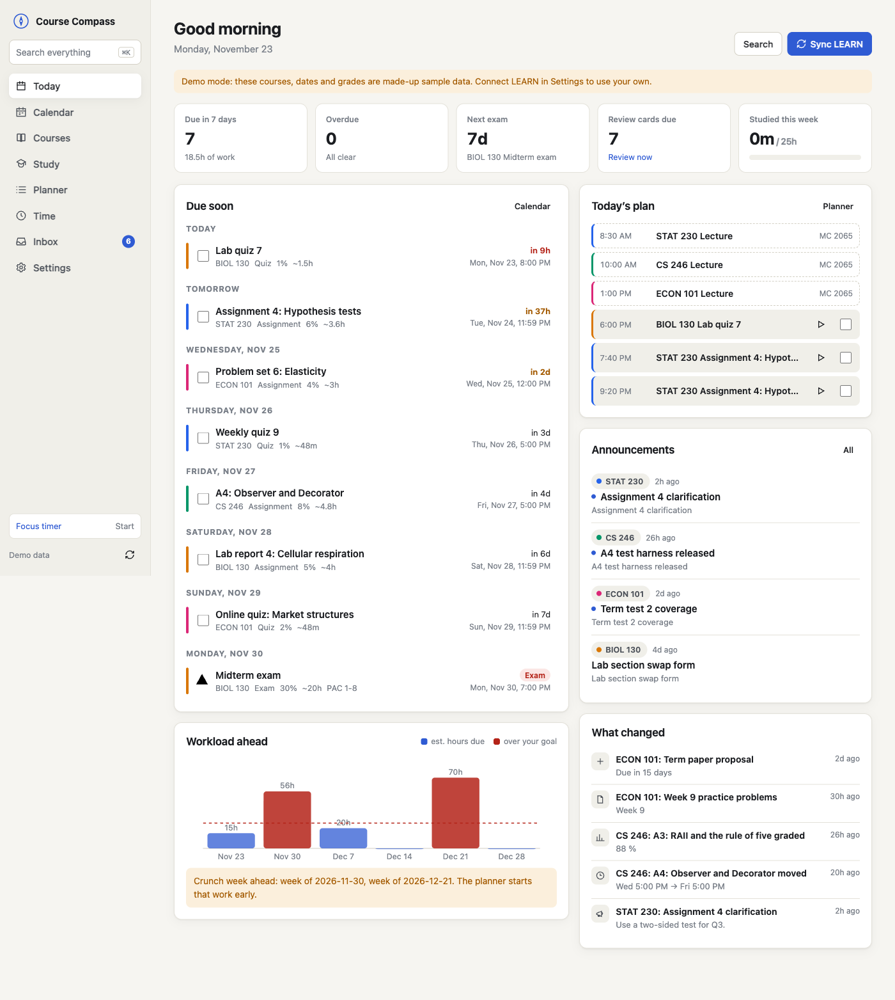

# The school hub

`course-compass serve` opens a local web app that pulls everything from Waterloo LEARN (D2L Brightspace) into
one place, so you rarely need to open LEARN itself. It runs on your Mac, binds to `127.0.0.1` only, and keeps all
data in `~/.course-compass/` (set `COURSE_COMPASS_HOME` to move it).



## Try it without LEARN

```bash
python3 -m course_compass demo            # five made-up courses, opens http://127.0.0.1:8766/
python3 -m course_compass demo --reset    # rebuild the demo around today's date
```

The demo is in its own folder (`~/.course-compass-demo`) and never touches your real data.

## Connect your LEARN account

```bash
pip install ".[sync]" && python3 -m playwright install chromium     # optional, for the browser sign-in
python3 -m course_compass login            # a browser opens: sign in with WatIAM and Duo, it closes itself
python3 -m course_compass sync             # pull everything, index your notes, build the study plan
python3 -m course_compass serve            # open the hub
python3 -m course_compass schedule         # optional: sync at 7:30, 12:30 and 18:00 every day (macOS)
```

No Playwright? `course-compass login --cookie` asks you to paste the `Cookie` header from a signed-in LEARN tab
(browser DevTools, Network, any request to `learn.uwaterloo.ca`). Your password is only ever typed into
Waterloo's own sign-in page; Course Compass never sees or stores it.

When the session expires, the next sync tries a silent headless refresh with the saved browser profile. If that
fails you get one "Sign in to LEARN again" alert (at most every 12 hours). Due dates keep flowing from the LEARN
calendar feed if you paste its link in Settings.

## What it does

| Area | What you get |
|---|---|
| **LEARN sync** | Courses, assignments (dropbox folders and instructions), quizzes, calendar events, announcements, content files, grades and the course outline. Read-only, one request at a time, about 3 a second. A step that fails does not delete anything. |
| **Syllabus extractor** | Finds the outline (a content file named "Syllabus" or "Course outline", a link to `outline.uwaterloo.ca`, or the course overview) and pulls out the grading scheme, exam and due dates with times, instructor and TA emails, office hours and the late policy. Every value is shown with the exact line it came from. Dates that disagree with LEARN by more than a day are flagged. |
| **Today** | Due soon grouped by day, overdue work, next exam countdown, review cards due, hours studied against your weekly goal, today's classes and study blocks, latest announcements, what changed, and a workload chart that flags crunch weeks. |
| **Calendar** | Month, week and agenda views with course filters and colours. Add your own to-dos and exams. |
| **Apple Calendar** | Live subscription feeds (`webcal://`): everything, deadlines, exams, study plan, classes. Reminders 2 days and 3 hours before each deadline (configurable). Re-checked by Calendar on its own, so moved dates follow. The links hold a secret you can replace. `course-compass calendar` writes one-off `.ics` files instead. |
| **Courses** | One page per course: overview, work, announcements (sanitized HTML), content with downloaded files, grades, syllabus, and notes. |
| **Grades** | Current standing on the weight graded so far, projected final, what-if scores per component, and "what do I need": the average needed on the rest, and on the final exam alone, for your target. Uses LEARN's weights when it has them, else the syllabus scheme, else a clearly labelled unweighted average. |
| **Notes** | Slides (.pptx), PDFs, Word files, LEARN pages and notebooks are turned into text with page and slide numbers and indexed automatically after each sync. Scanned PDFs are read with OCR when `tesseract` is installed. Add your own notes in `~/.course-compass/notes/<COURSE CODE>/`. |
| **Study** | Ask (cited answers or "Not in your notes."), Explain (simplify in layers, real-life examples), Tutor, Practice (quizzes, spaced review, cram) and Exam prep. Math renders with KaTeX. |
| **Tutor** | *Walk me through it*: hints one at a time, the full solution only when you ask. *Check my work*: finds the first wrong step without rewriting your answer. *Explain it back*: you explain a concept, it scores what you covered and missed against your notes and asks a follow-up. Course facts cite your notes; anything from outside them is labelled. |
| **Exam prep** | For each exam, a day-by-day plan: re-learn weakest topics first while more than a week out, daily practice in the last week, a mixed practice exam and your past misses in the last 48 hours. |
| **Planner** | Estimates hours for each piece of work (by type and weight, then calibrated against the time you actually log), and fits study blocks into the hours you say you study, earliest deadline first, finishing a day early, never during classes, with a daily cap. Work that cannot fit is flagged with how many hours short it is. |
| **Time** | Focus timer (25/5 by default) tied to a course or an assignment, manual logging, a weekly report of hours by day and planned against actual per course. |
| **Inbox and alerts** | Every change found by a sync (new work, moved due dates, new grades, announcements, files, removed items, syllabus conflicts). Mac notifications, and an optional phone push through an ntfy topic you choose (short titles only). A morning digest: `course-compass digest`. |
| **Search** | ⌘K or `/` searches work, announcements, files and the full text of your notes. |
| **Checklists** | Assignment instructions are split into a step checklist you can tick off and edit. |
| **Timetable** | Import your class schedule `.ics` so the planner keeps lecture times free. |

## Commands

| Command | What it does |
|---|---|
| `login` | Sign in to LEARN (`--cookie` to paste a cookie instead, `--base` for another D2L site) |
| `logout` | Forget the session (`--browser` also deletes the saved browser profile) |
| `sync` | Pull everything, then re-index notes, re-plan and send alerts (`--no-files`, `--quiet`) |
| `serve` | Open the hub (`--port` 8765, `--host`, `--allow-host`, `--no-browser`) |
| `demo` | The hub on made-up data (`--reset`, `--no-serve`) |
| `today` | What's due, in the terminal (`--days` 7) |
| `digest` | The morning digest as Markdown (`--notify` also shows a Mac notification) |
| `calendar` | Write `.ics` files (`--feed all\|deadlines\|exams\|study\|classes`, `--out-dir`) |
| `grades` | Standing and what you need per course (`--target`) |
| `index` | Rebuild the notes index |
| `timer start\|stop\|status` | Study timer (`--course STAT230`) |
| `schedule` | Sync automatically at set times with a macOS LaunchAgent (`--times`, `--remove`, `--dry-run`) |

## How the sync talks to LEARN

It uses the documented Brightspace Valence API with your own session cookies, the same requests the LEARN
website makes for you. Versions were checked against `learn.uwaterloo.ca/d2l/api/versions/` (LE 1.100, LP 1.64).

| Data | Endpoint |
|---|---|
| Courses | `/d2l/api/lp/1.64/enrollments/myenrollments/?orgUnitTypeId=3` (bookmark paging) |
| Assignments | `/d2l/api/le/1.100/{ou}/dropbox/folders/` and `.../mysubmissions/` (submitted detection) |
| Quizzes | `/d2l/api/le/1.100/{ou}/quizzes/` |
| Calendar | `/d2l/api/le/1.100/{ou}/calendar/events/myEvents/` |
| Announcements | `/d2l/api/le/1.100/{ou}/news/` |
| Content and files | `/d2l/api/le/1.100/{ou}/content/toc` and `.../content/topics/{id}/file` |
| Grades | `/d2l/api/le/1.100/{ou}/grades/values/myGradeValues/` and `.../grades/final/values/myGradeValue` |

Redirects are never followed (a redirect means the session expired), the cookies are only ever sent to the
LEARN host, and a sign-in page returned instead of JSON is treated as an expired session. Course outlines on
`outline.uwaterloo.ca` are public and are fetched without your cookies.

**Honest status:** the sync is tested against a fake Brightspace that returns the documented response shapes,
not against a live LEARN account. The first real sync is the real test: if a course looks wrong, run
`course-compass sync` in a terminal and read the log, which names every step that failed.

## Phone access

Not set up yet, by design. The hub only listens on `127.0.0.1`. The calendar feeds already reach your phone
through Apple Calendar once your Mac is reachable from it. To open the whole hub from your phone later, run it
behind something private such as Tailscale and pass `--host` and `--allow-host` with that address. Do not
expose it to the open internet.
